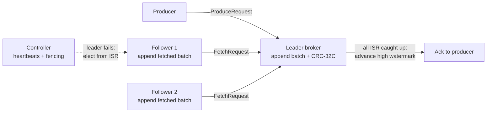

# Rachit Kumar Singh

**B.Tech CSE '27 @ KIIT (8.31 CGPA) • Ex-SWE Intern @ Accenture • Distributed Systems, Backend & AI Engineering • Seeking Jan–Jun 2027 SDE Internships**

---

I build backend and distributed systems from first principles, then prove them by breaking them: killing processes, partitioning networks, and publishing only the numbers I measured.
My two flagship builds are a Kafka-style commit log in Java 21 and a vector database in Python, each benchmarked against the real thing (Apache Kafka, FAISS) with the gaps stated honestly.
I care about correctness under failure, test coverage that means something, and systems I can defend line by line in an interview.

**Accenture, Associate Software Engineer Intern (May–Jul 2026).** Built a FastAPI RAG chatbot for L1 ticket triage over a knowledge base of resolved tickets, with confidence-scored root-cause analysis; defined 13 evaluation criteria and 15 process rules in JIRA across 4 teams. Selected among the top 5 interns to present before a visiting Japanese delegation at an Agentic AI conference.

## Flagship Systems & Verified Benchmarks

| Project | What it is | Verified results | Stack | Links |
|:--|:--|:--|:--|:--|
| **LogForge** | Kafka-style distributed commit log, ~11K lines of Java 21 on the JDK alone | **0** acknowledged records lost across 10 SIGKILL leader failovers (1.48M records acked at `acks=all`) Fixed a blocking socket close (~7 s heartbeat stall): false failovers **22/22 → 0/22** 5 Docker Compose chaos scenarios + 100 crash-recovery kills 126 JUnit 5 tests in GitHub Actions CI | Java 21, Java NIO, CRC-32C, leader-follower replication, ISR, Docker, Next.js |   |
| **VectorForge** | Vector database from first principles, no ANN library in the engine | HNSW: **976 queries/s at 0.954 recall@10** on 200k SIFT1M vectors (**42.8x** faster than exact search) int8 scalar quantization: **4x** storage cut at 0.9766 recall@10 100/100 crash-recovery kills survived via CRC32 WAL Benchmarked against FAISS: 9.5x gap measured and explained 206 engine tests (95.36% coverage) + 30 frontend tests | Python, NumPy, FastAPI, Next.js, React, TypeScript |   |
| **APIWatch** | Production-style task-management REST API with observability | Eliminated **2 race conditions** (duplicate idempotent writes, lost updates) via Idempotency-Key checks and optimistic concurrency **51 tests at 98.34% coverage** behind an 85% CI gate Prometheus + Grafana dashboard, liveness/readiness probes | Python, FastAPI, SQLAlchemy, PostgreSQL 16, SQLite, Prometheus, Grafana |  |
| **AI Resume Screening Assistant** | Full-stack resume classifier and JD matcher | 2-layer PyTorch NN over 2,362 real resumes (1,890/472 split) Test accuracy **62.9% → 67.4%** (macro F1 66.7%) Confidence-calibrated "UNCERTAIN" abstention on ambiguous input | Python, PyTorch, Scikit-learn, spaCy NER, TF-IDF, FastAPI, React |  |

### How LogForge acknowledges a write (`acks=all`)

<b>Engineering notes: what these systems deliberately do not do (yet)</b>

 

- **LogForge:** single fixed controller (no Raft), no TLS on the binary protocol, no zero-copy `sendfile`, compression or transactions. Benchmarks vs Apache Kafka 3.9: faster in 2 configurations, slower in 2, the rest within run-to-run noise.
- **VectorForge:** 9.5x slower than FAISS at matched recall on SIFT1M (Python loops vs optimised C++). Crash tests use process kills, not power loss.
- **APIWatch:** single instance; load test was sequential, not concurrent.

Knowing where a system stops is part of building it.

## Tech Stack

**Languages**

**Backend & Systems**

**Frontend**

**DevOps & Observability**

**AI / ML**

## Where My Commits Go

  

## Problem Solving

